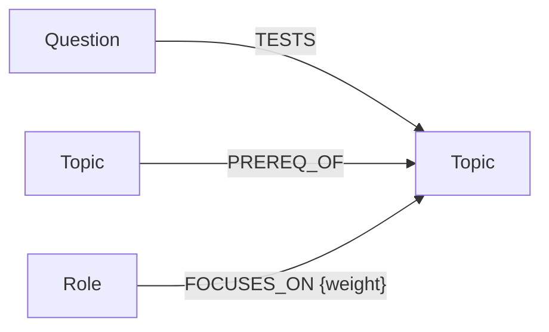
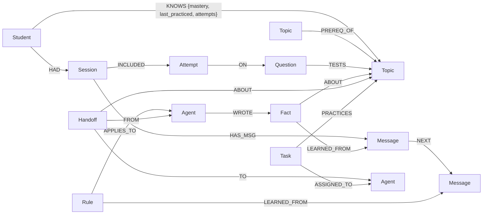

# Graph data model (design sketch)

There are two kinds of graphs in one FalkorDB instance:

1. **`catalog`**: shared, read-only knowledge (topics, prerequisites, questions, roles). Same for everyone.
2. **`pm_<student_id>`**: one private memory graph **per student**. Agents read and write here.

Why separate graphs per student?
- **Privacy / isolation:** Riya's memory physically can't show up in Arjun's queries.
- **Concurrency:** FalkorDB runs writes one at a time *per graph*, so different students' writes don't wait for each other.
- **"Forget me":** deleting a student = deleting one graph.

---

## 1. Catalog graph



| Node | Properties |
|---|---|
| `Topic` | `id`, `name`, `area` (DSA / OS / DBMS / CN / OOP / Data) |
| `Question` | `id`, `text` (written by us), `difficulty` (1–3), `ideal_answer_points` |
| `Role` | `id`, `name` (Product SDE / Service-based / Data Analyst) |

`(A)-[:PREREQ_OF]->(B)` means "learn A before B" (e.g. Queues → BFS).

---

## 2. Student memory graph `pm_<id>`



(Topics and their `PREREQ_OF` edges are **copied** from the catalog when a student is created, so multi-hop queries work inside one graph. Questions are copied only when attempted.)

### Nodes
| Node | Properties | Memory type |
|---|---|---|
| `Student` | `id`, `name`, `target_role`, `created_at` | semantic |
| `Topic` | `id`, `name`, `area` | (copy of catalog) |
| `Session` | `id`, `started_at`, `ended_at`, `summary` | episodic |
| `Message` | `id`, `role` (user/agent), `agent`, `text`, `ts` | episodic (history) |
| `Attempt` | `id`, `score` (0–1), `feedback`, `ts` | episodic |
| `Question` | `id`, `text`, `difficulty` | (copy of catalog) |
| `Fact` | `id`, `text`, `confidence`, `ts` | semantic |
| `Rule` | `id`, `text`, `active`, `ts` | **procedural** |
| `Agent` | `name` (coach / interviewer / tutor / planner) | shared state |
| `Handoff` | `id`, `reason`, `ts`, `status` (open/picked) | shared state |
| `Task` | `id`, `title`, `due`, `status` (todo/done) | shared state |

### Relationships
| Relationship | Meaning |
|---|---|
| `(Student)-[:KNOWS {mastery, last_practiced, attempts}]->(Topic)` | how well the student knows a topic |
| `(Topic)-[:PREREQ_OF]->(Topic)` | learning order |
| `(Student)-[:HAD]->(Session)` | sessions over time |
| `(Session)-[:HAS_MSG]->(Message)`, `(Message)-[:NEXT]->(Message)` | conversation history, in order |
| `(Session)-[:INCLUDED]->(Attempt)-[:ON]->(Question)-[:TESTS]->(Topic)` | mock interview results |
| `(Fact)-[:ABOUT]->(Topic or Student)` | what a fact is about |
| `(Rule)-[:APPLIES_TO]->(Agent)` | which agent must follow the rule |
| `(Fact or Rule)-[:LEARNED_FROM]->(Message)` | **provenance**: where the memory came from |
| `(Agent)-[:WROTE]->(Fact / Rule / Attempt / Task)` | which agent wrote it |
| `(Handoff)-[:FROM]->(Agent)`, `-[:TO]->(Agent)`, `-[:ABOUT]->(Topic)`, `-[:IN]->(Session)` | agent-to-agent handoff |
| `(Task)-[:ASSIGNED_TO]->(Agent)`, `(Task)-[:PRACTICES]->(Topic)` | shared task board |

---

## 3. Memory rules (simple, explainable, no ML)

**Mastery update** after each graded attempt (score 0–1):
```
new_mastery = 0.6 × old_mastery + 0.4 × score
```
Example: old 0.5, score 0.3 → 0.6×0.5 + 0.4×0.3 = 0.42

**Forgetting over time** (worked out when reading, nothing stored):
```
effective_mastery = mastery × 0.5 ^ (days_since_last_practice / 14)
```
Example: mastery 0.8, practised 14 days ago → 0.4. That makes it "due for revision".

**Thresholds:** weak < 0.5 · mastered ≥ 0.6 · due for revision when effective < 0.5 *and* mastery ≥ 0.5.

---

## 4. Queries we'll need (described in words; write the Cypher on Oct 15)

1. **Context pack** (run before every agent reply): the student's mastery on the current topic, last 3 attempts on it, active rules for *this* agent, open tasks for this agent, and the newest open handoff to this agent.
2. **Root-cause weakness (multi-hop):** start at a weak topic, walk back up to 3 `PREREQ_OF` steps, and return prerequisites that are also weak. ("BFS is hard because Queues are weak.")
3. **Ready to learn:** topics where every prerequisite is mastered (≥ 0.6) but the topic itself isn't yet.
4. **Due for revision:** topics where forgetting has pushed effective mastery under 0.5.
5. **Welcome back:** the latest finished session's summary + its attempts.
6. **Foundational topics:** PageRank on the catalog prerequisite graph. High score = many topics depend on it.
7. **Memory panel:** all facts and rules with the message they came from and the agent that wrote them.
8. **Forget a fact:** delete one Fact by id. **Forget me:** delete the whole student graph.
