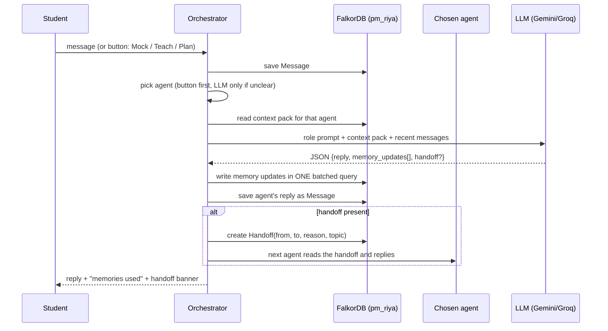

# Agents and how they coordinate

## The 4 agents
All four use the same LLM with a different role prompt. None of them keeps memory "in its head": **everything goes through the student's graph**, which is how they share.

| Agent | Job | Reads from memory | Writes to memory | Can hand off to |
|---|---|---|---|---|
| **Coach** | Front door. Greets, recaps, routes | last session, due revisions, open tasks | session summary, facts about goals | anyone |
| **Interviewer** | Mock question → grade answer | weak/ready topics, past attempts, its rules | Attempt + mastery update | Tutor (score low), Planner |
| **Tutor** | Explains a topic your way | preferences (rules), weak prerequisites | rules ("likes code examples"), facts | Interviewer (to re-test) |
| **Planner** | Weekly plan | weak, due, ready topics, role focus, foundational topics | Tasks assigned to agents | Coach |

## One chat turn

## What the LLM must return (contract, in words)
- `reply`: what the agent says
- `memory_updates`: a list where each item is one of:
  - a **fact** (text, which topic/student it's about, confidence)
  - a **rule** (text, which agent it applies to)
  - a **score** (Interviewer only: question id, score 0–1, short feedback)
  - a **task** (Planner only: title, topic, due date, assigned agent)
- `handoff` (optional): to which agent, why, about which topic

If the JSON is broken → retry once → else show the reply and skip memory writes.

## Handoff example
1. Interviewer grades Riya's BFS answer at 0.3.
2. It writes the Attempt, BFS mastery drops, and it returns `handoff: {to: tutor, reason: "struggled with BFS level order", topic: BFS}`.
3. The orchestrator saves a `Handoff` node and calls the Tutor at once.
4. The Tutor's context pack includes that handoff **plus** the root-cause query (Queues weak) **plus** Riya's rule "likes code examples".
5. The Tutor explains Queues → BFS with code and marks the handoff as `picked`.
6. In the background, the Planner adds the task "Retry BFS" for tomorrow, assigned to the Interviewer.

## Why this counts as "coordination"
- **Shared state:** all agents read and write the same student graph.
- **Explicit handoffs:** `Handoff` nodes record who passed what to whom, and why.
- **Task board:** the Planner gives tasks to other agents; they pick them up next session.
- **Concurrency:** background updates (Planner + Coach) can run at the same time. Different students never block each other.
